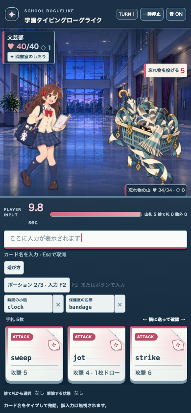
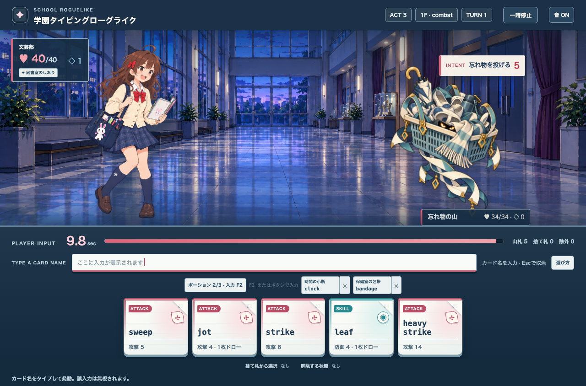

# 忘れ物の山 v2 比較 — Issue #155

v1は1065×1477の透明キャンバスの可視領域が上下左右すべての端まで達していた。左のリボン、右のかご・飾り、上の傘柄、下の飾りが切れた輪郭として見えた。v2は元画像を参照した編集で、青灰色のかご、クリームと青緑の布、金色の傘柄・飾り、琥珀色の目を維持し、四辺の形が最後まで見える。両画像は別版として保存し、v1を上書きしていない。

| 版 | alpha 16以上の外接矩形 | 判定 |
| --- | --- | --- |
| v1 | 0,0..1064,1476 | 端で切れるためランタイム候補から外す |
| v2 | 47,55..1035,1431 | #153の安全余白11pxを満たす。元の配色と敵の輪郭を保つ候補としてランタイムで比較する |

v2にも編集可能な原本はない。連続動作の素材でもなく、#29の正式採用条件は満たさない。生成時の余白指定10％/8％に対して実際の余白は小さいため、次の制作回ではプロンプトだけに頼らず出力を計測する。

## 実際の戦闘画面

Act 3の校舎背景に対して敵は独立した透過層で見える。390pxでも傘柄、かご、目と吊り飾りが画面内に入り、敵HP・Intent・タイピング欄と重ならない。1280pxでは人物との距離と広い背景を保つ。自動E2Eで同じ戦闘の画像decode、Intentと入力欄のviewport内表示を確認した。これらは静止画の比較であり、原本化や動きの最終受入ではない。
