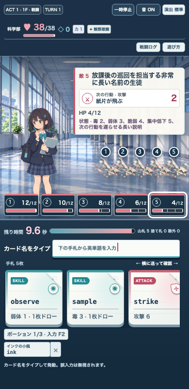
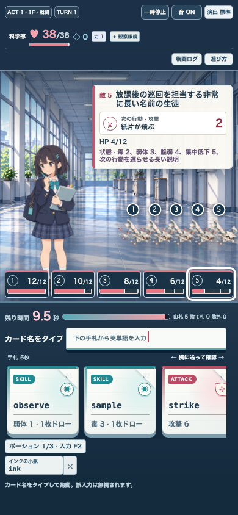
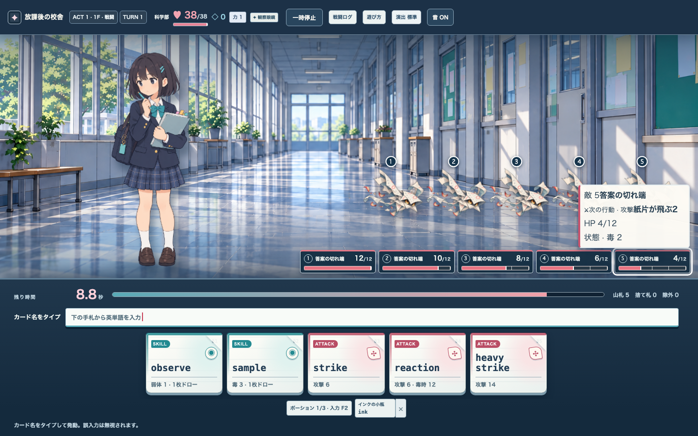

# Issue #170 · 複数敵の情報設計

3〜5体編成では、重なった立ち絵を直接の選択先にせず、番号付きの敵一覧を操作先にする。各項目はHPの量と現在値を常時表示する。フォーカス・ポインタ・対象選択中の敵は名前、次の行動、HP、ブロック、状態を詳細札で読む。1〜2体編成は従来の敵札を使う。

| 役割 | 表現 |
| --- | --- |
| 敵の位置・雰囲気 | 立ち絵 |
| 敵の識別と選択 | 番号付きのボタン、フォーカス枠 |
| HPの残量 | 分節したバーと現在値/最大値 |
| 行動の種類 | 記号と短い種別名 |
| 行動・状態の意味 | フォーカス時の詳細札、スクリーンリーダー名 |

立ち絵には一覧と同じ番号を常時表示する。v6のモバイル画像は、敵名と状態欄をテスト内で意図的に長くした表示検証用画像で、実コンテンツではない。390×800/844pxの両方で詳細札がステージ内に収まり、内部スクロールや文字の切断が生じないことを確認した。

検証: `npm run lint`、`npm run typecheck`、`npx vitest run tests/integration/multi-enemy-ui.test.ts`（3件）、`SCHOOL_RG_CAPTURE_MULTI=1 SCHOOL_RG_E2E_PORT=4194 npx playwright test tests/e2e/multi-enemy-ui.spec.ts`（5件）。390pxでは3/4/5体、800/844px高、1440pxでは5体を確認。5体編成で敵を選び、`strike` 入力で対象のHPが減ることと、一覧ボタンでの入力開始後にフォーカスが入力欄へ移ることを確認した。全体検証は親Issueへの統合後に実施する。

初回描画とタイマー更新で時間単位が異なっていたため、更新経路も「秒」にそろえ、meterの値も更新する。v6はこの作業ツリーを配信する専用のViteポート4194で撮影した。v3/v4/v5画像は以前の表示記録として保持し、レビューにはv6を使用する。

敵絵と背景は現在の制作候補であり、最終アートの採用判断は #29 のゲートに属する。
