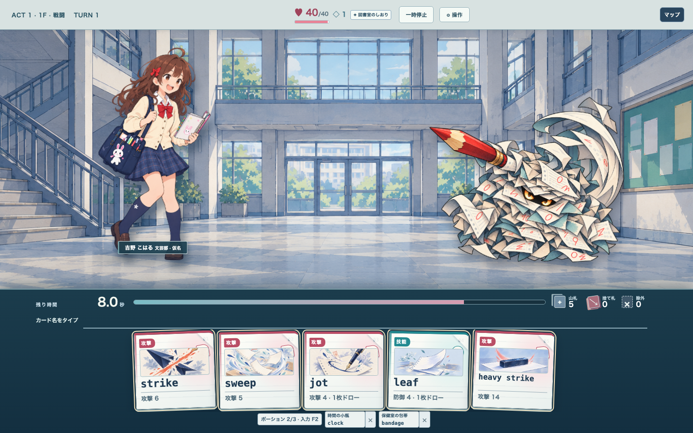
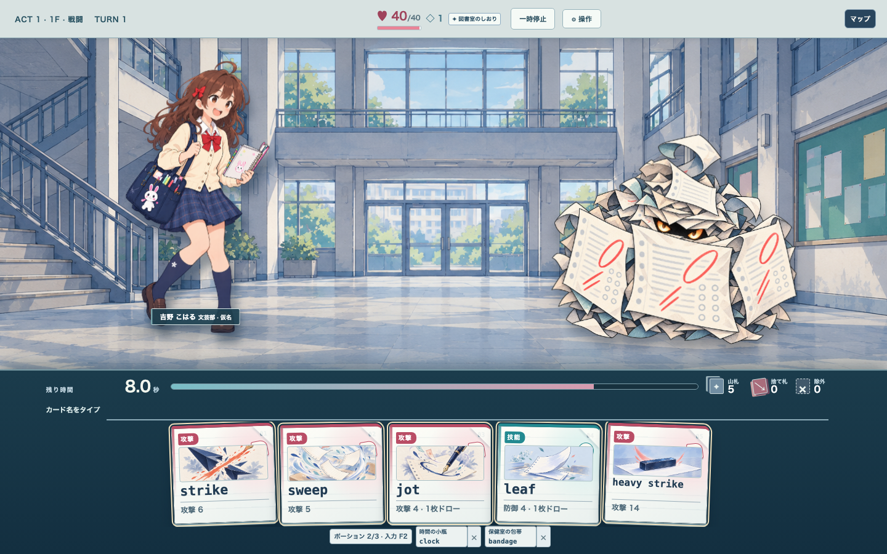
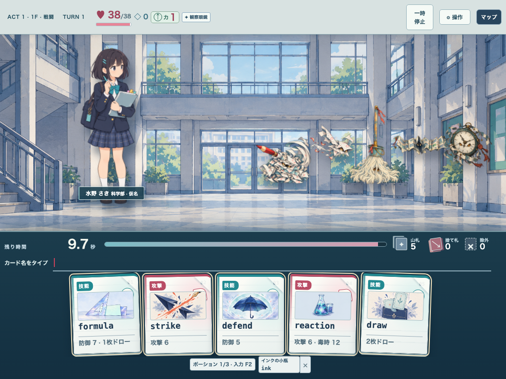
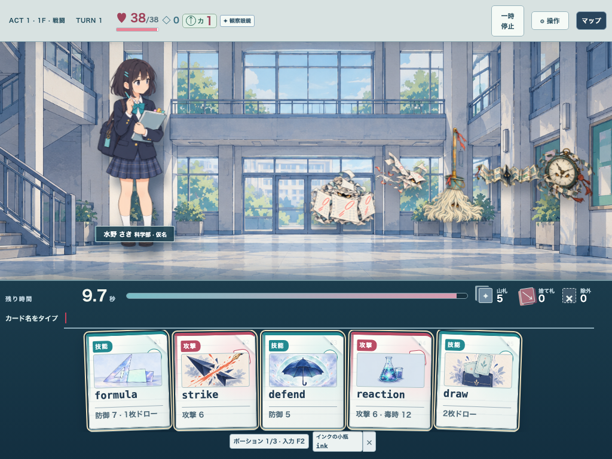
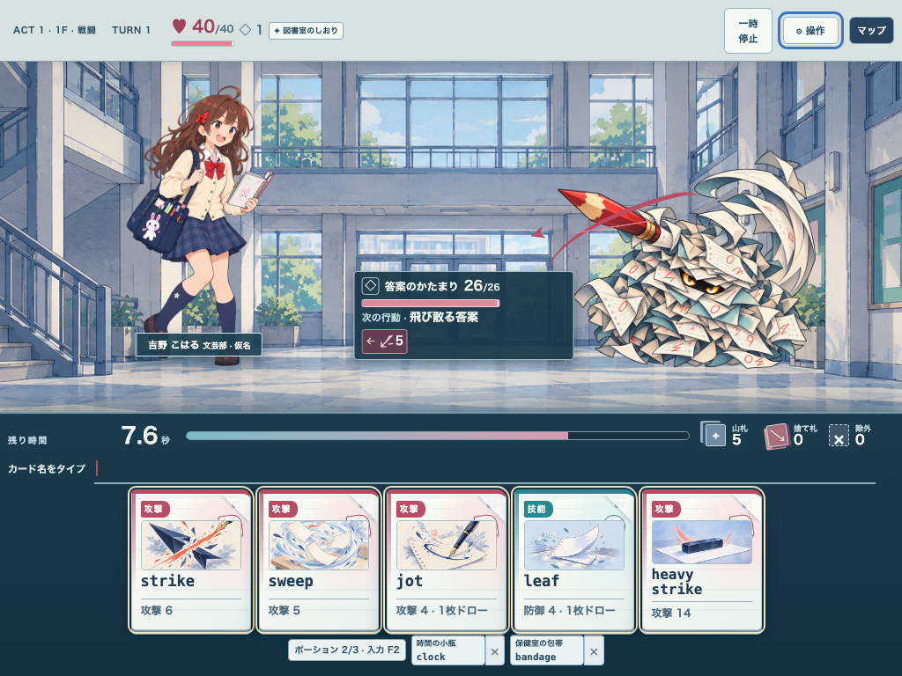
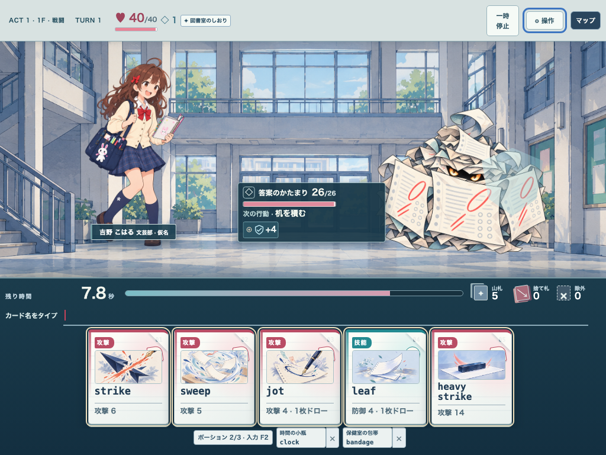
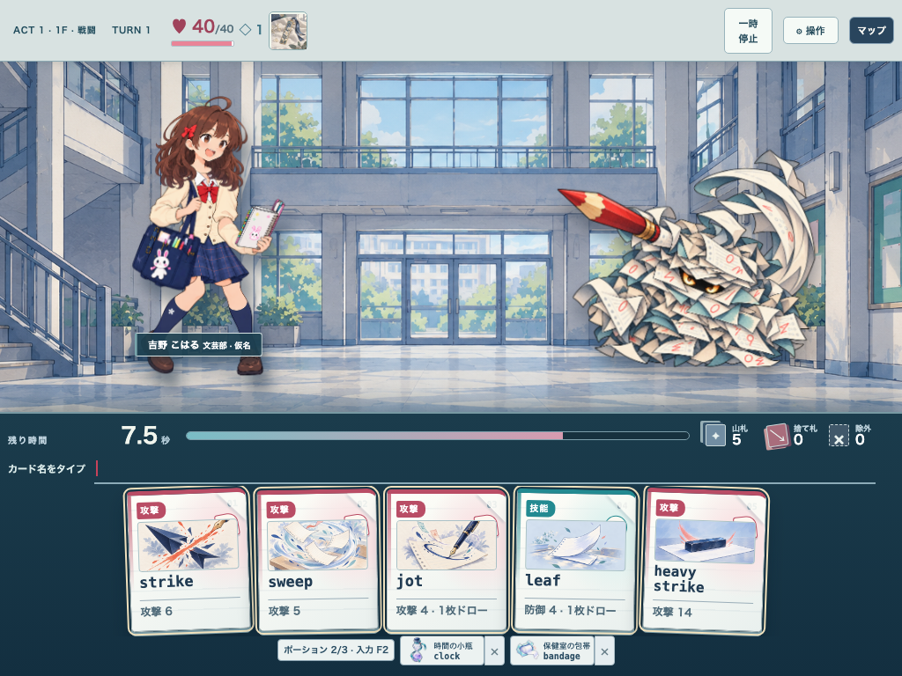
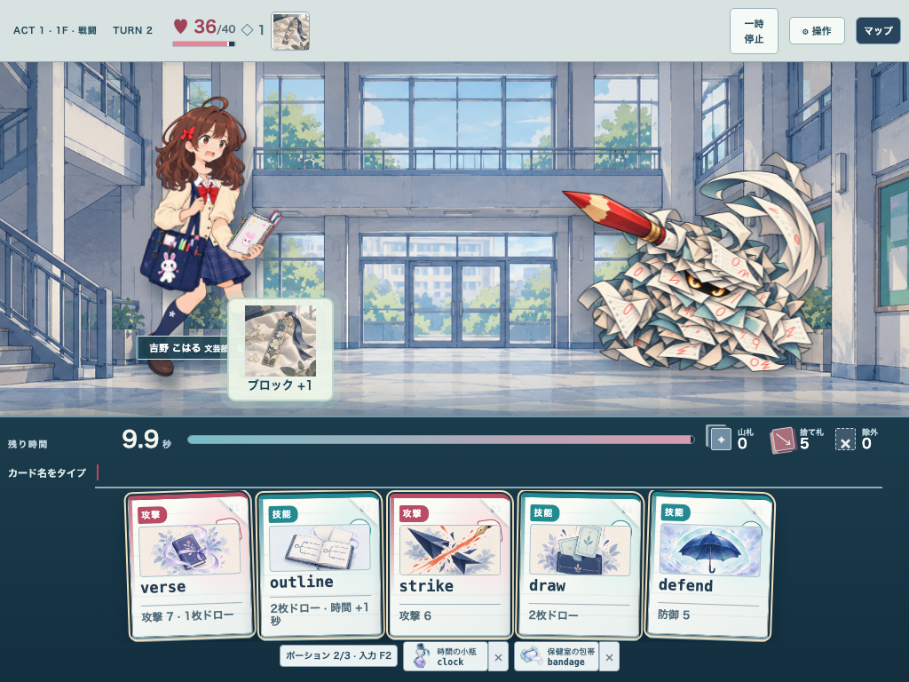
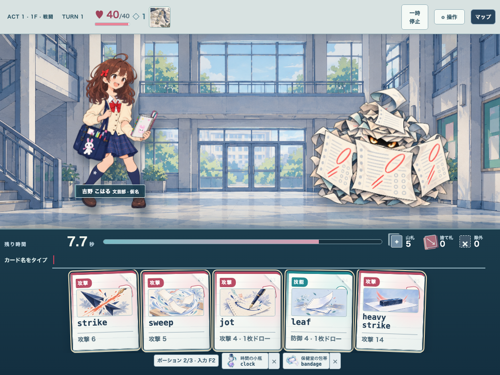
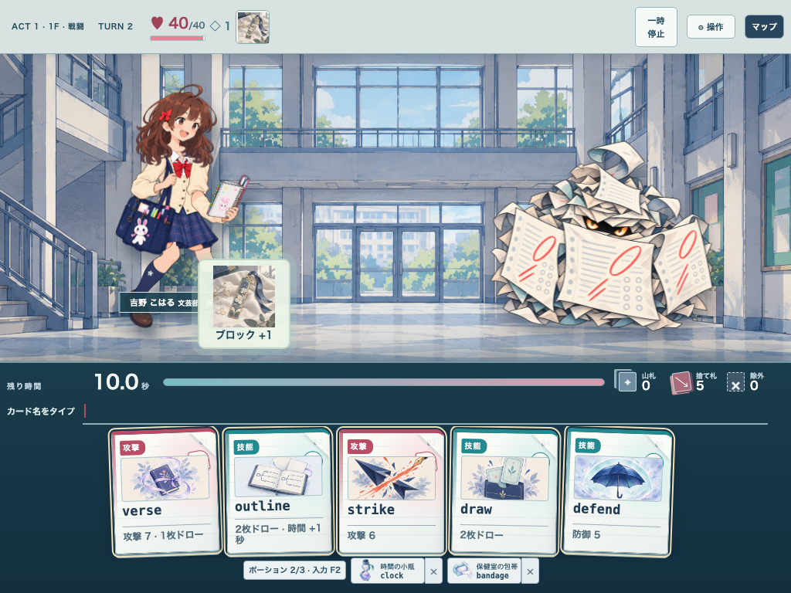

# Paper heap action candidate review (#317)

Status: **candidate**, tested in the #261/#303 GameShell with the actual seeded encounter. This is one enemy among the 31 catalogued enemies. Source, SHA-256 and prompt contracts are in [the source record](issue317-paper-heap-action-sources.md). No human first-sight recognition study or physical iPad check has been completed.

## Gameplay image contract

| State | Image tells the player | Text/numeric supplement |
| --- | --- | --- |
| Attack Intent | The long red pencil reaches player-left beyond the paper body; the pages sweep backward. | Exact attack value and target stay in the Intent UI. |
| Guard Intent | Three broad exam sheets cover the body as a front shield; the pencil is hidden. | Exact Block value stays in the Intent UI. |
| Card hit | The mound compresses low and large pages break upward. | Exact HP change stays in the result mark. |
| Quiet / reduced motion | The chosen action pose stays still; there is no image cycling. | Exact values remain available. |

The domain Intent owns the choice. Image identity maps only `paper-intent-hit` and `paper-intent-guard`; unsupported intents fall back to idle. The 650 ms enemy windup shows the same pose before the Intent resolves. The resolved Intent ID remains attached through the result interval, so a new next-turn Intent does not change the depicted action early.

## Actual GameShell captures

Enemy labels, HUD, roster, body cues and trajectory are hidden in the visual-only captures. The rest of the battle stays visible to retain scene scale.

| Condition | Attack | Guard |
| --- | --- | --- |
| 1 enemy, 1440×900, visual-only |  |  |
| 5 enemies, 1024×768, visual-only |  |  |
| 1 enemy, 1024×768, quiet |  |  |

Additional checks: [five-enemy quiet guard](previews/issue317-v6/paper-heap-five-enemies-guard-quiet-visual-only-1024.png) and [single-enemy quiet hit](previews/issue317-v6/paper-heap-hit-quiet-1440.png).

Selected target inspection keeps the same pose visible at 1.35× while the enemy slot and stage bounds stay fixed. The action pose is held still while selected, so the idle cycle cannot briefly obscure the meaning. [Attack at 1024](previews/issue317-v10/paper-heap-five-enemies-attack-selected-1024.png), [guard at 1024](previews/issue317-v10/paper-heap-five-enemies-guard-selected-1024.png), [attack at 1440](previews/issue317-v10/paper-heap-five-enemies-attack-selected-1440.png), [guard at 1440](previews/issue317-v10/paper-heap-five-enemies-guard-selected-1440.png), [quiet guard at 1024](previews/issue317-v10/paper-heap-five-enemies-guard-quiet-selected-1024.png) and [quiet guard at 1440](previews/issue317-v10/paper-heap-five-enemies-guard-quiet-selected-1440.png) are actual GameShell captures. #303's body cue and numeric Intent detail remain attached to the selected target. These captures establish visible differences at normal screen widths, not a first-sight human perception pass.

## Judgment and remaining gate

### #323 integrated causal sequence (2026-10-31)

The #324 action candidate was checked inside the #323 integrated GameShell, with its hero rig, card presentation and result effects enabled. The attack pencil now thrusts left during the 650 ms enemy action window and recoils after it; the guard sheet braces forward and settles. The stage rectangle stays fixed. Quiet mode keeps the attack/guard pose as a still. The source image and enemy ID remain unchanged through these transitions.

| Actual scene | Preview | Outcome |
| --- | --- | --- |
| Attack, 1024×768, enemy HUD/Intent cue hidden |  |  |
| Guard, 1024×768, enemy HUD/Intent cue hidden |  |  |

[Attack contact at 1440×900](previews/issue317-integrated/paper-attack-1440-contact.png) and [card hit at 1440×900 with enemy HUD hidden](previews/issue317-integrated/paper-card-hit-1440-resolved-art-only.png) show the other two parts of the sequence. In the seeded attack the hero's Block 1 absorbs one point, the hero reacts and HP changes 40→36. In guard, the shield remains across the front of the mound and enemy Block becomes 4. The typed `strike` collapses the mound and changes its HP 26→20. The screenshot at contact is one animation sample; it cannot prove that every frame communicates the same action.

**Visual judgment:** at one enemy, the long pencil and front shield establish different actions without the enemy's text label. The hero reaction connects attack to target better than the prior still pose, and the collapsing paper body connects a typed strike to enemy damage. The guard image communicates covering up; the exact Block amount still requires the meter. At five enemies in 1024 px, the enemy-specific action and target remain difficult to infer without #303's local cue/Intent UI. The art-only screenshots still contain the surrounding game HUD and player item popover; they are a test of enemy action art with its local labels removed, not a pure image-only comprehension study. A first-sight human perception pass and physical iPad check are still required.

The added integrated E2E covers attack/guard at 1024 and 1440, seeded preview→action→resolution, stable stage bounds, enemy Block/hero HP, hero hit reaction when the integrated rig is present, and typed card hit. This tests state and timing, not whether a new player understands the cause at a glance.

The v2 pencil and shield separate in actual 1024-pixel five-enemy screenshots more clearly than v1, with both pose and source enemy identity retained. In the 5-enemy layout, each enemy is still about a tenth of the screen width. The exact action of all five enemies cannot be inferred from art alone; #303's localized Intent UI still carries that load. The action comparison is a candidate visual review, not proof that an unfamiliar player interprets the shapes correctly at 48–80 px. The hit pose has only been reviewed in a single-enemy scene. The PNGs remain whole-body pose layers with no separately editable pencil, shield or paper parts. A stable production rig, all 31 enemy action sets, target/strength vocabulary across enemy behaviors, first-sight user study and physical iPad confirmation remain open under #29/#245/#303.

### Unmade enemy action sets

The content registry and Act encounter table contain 31 enemies. `paper-heap` is the sole candidate with action poses; these 30 still have portrait-only art, with no enemy-specific attack/defense/status/hit action set. The list includes the Act 1 paired elite `paper-scrap`.

| Act | Enemy IDs without action sets |
| --- | --- |
| 1 | `late-pass`, `lost-homework`, `hall-mop`, `folded-school-map`, `hall-monitor`, `paper-scrap`, `notice-board`, `school-gate`, `final-exam`, `gym-scoreboard` |
| 2 | `chalk-cloud`, `safety-sign`, `lab-magnet`, `beaker-mist`, `lab-coil`, `library-cart`, `stairwell-echo`, `library-index`, `club-auditor`, `lab-ventilation` |
| 3 | `night-announcement`, `window-shadow`, `empty-desk`, `stage-spotlight`, `archive-clock`, `lost-and-found`, `night-locker`, `last-bus`, `closing-bell`, `graduation-curtain` |

## Verification

On the v2 source tree: `npm run lint`, `npm run build`, `npm run check:art` passed. `CI=1 SCHOOL_RG_E2E_PORT=47231 ISSUE317_CAPTURE_DIR=docs/art/previews/issue317-v10 npx playwright test tests/e2e/enemy-action-art.spec.ts` passed **11/11**: 1024/1440 attack and guard, action/result timing, fixed stage bounds, quiet stills, single hit reaction, 1024/1440 five-enemy normal/quiet composition, selection enlargement/reversion and hiding an enemy's preview trajectory during the player's card result. This checks deterministic scene behavior, not first-sight comprehension.

After the #323 integrated audit: `CI=1 SCHOOL_RG_E2E_PORT=47243 npx playwright test tests/e2e/enemy-action-causality.spec.ts` passed **5/5** on the integrated tree. The candidate #324 tree passed **16/16** action E2E including this new test. These local results precede the final static/build check and updated PR CI.
