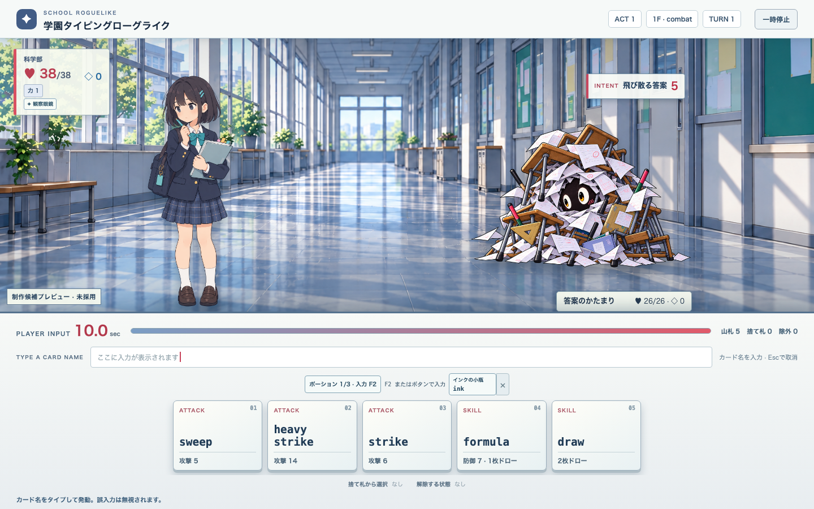
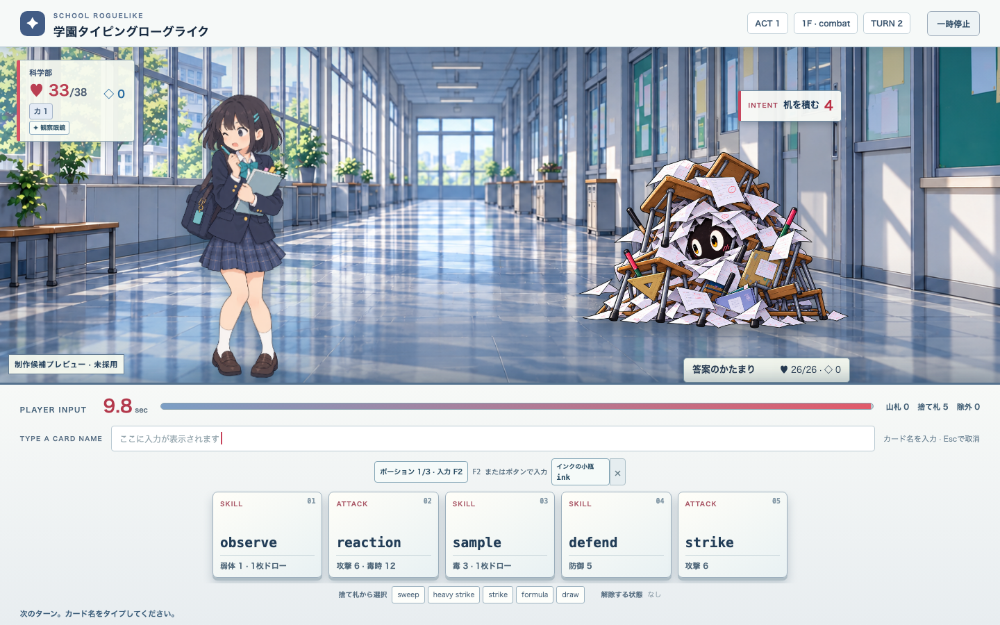
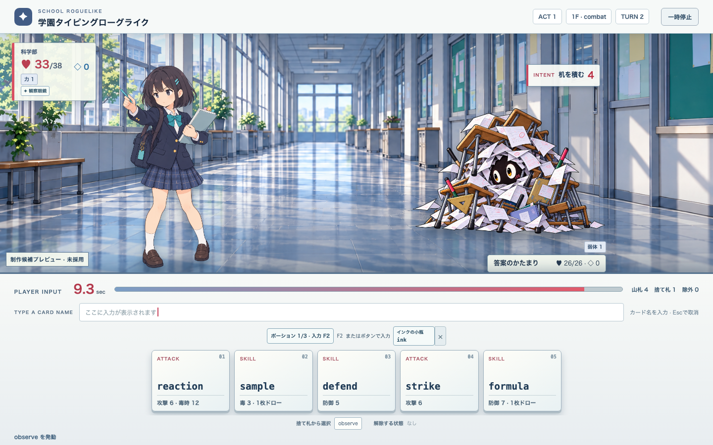

# 真面目な子・候補3ポーズの戦闘プレビュー

Issue [#84](https://github.com/sato0825/school-rg/issues/84)、親 [#29](https://github.com/sato0825/school-rg/issues/29)。この画面は候補の比較用です。採用済み素材、編集可能原本、完成アニメーションではありません。

`npm run dev` の開発画面で `?artPreview=1` を付けて開き、科学部を選んで戦闘ノードに入ります。通常画面は従来の仮画像のままです。科学部だけが3ポーズ候補を表示し、他部活は代替画像を使います。

- 待機: 入力待ちとターン進行中に表示。
- 発動: カード名の入力完了後に約380ms表示。入力判定と同じイベントから切り替える。
- 被弾: 敵Intentの解決でHP損失が発生した後に約420ms表示。防御だけでHPが減らない時は切り替えない。
- 敵は予告どおりの敵フェーズで行動する。プレビューの表示時間は敵の独立時計ではない。

E2Eは3状態の切替と待機への復帰、狭い画面でのキャラと操作領域の分離を確認します。絵の同一性、ポーズ間の補間、接地位置、線と陰影、基準画との一致は目視審査が必要です。候補PNGには編集可能な部位別原本がなく、#29の完成条件は満たしていません。

実画面の初回確認で、画像の読込前に空白フレームが見えました。候補3枚を起動時に先読みし、E2Eでは画像URLだけでなく `naturalWidth > 0` を確認します。読込後の短いポーズ切替を確認したもので、補間アニメーションの品質合格ではありません。

## 実画面の確認画像

以下は同じ1440×900の戦闘画面で撮影したフレームです。開始直後に読み込み待ちをしてから撮影しています。画面上で広い廊下背景、独立した味方・敵、入力帯の分離は確認できました。3ポーズ間で脚と腕の輪郭が瞬時に切り替わるため、自然な補間としては未合格です。

| 待機 | 被弾 | 発動 |
| --- | --- | --- |
|  |  |  |

狭幅390×844でも味方・敵と操作帯は分離できましたが、HUDの余白と読みやすさは引き続き調整対象です。画像・URL・自動テストの成功は、基準画との人物同一性や量産品質の承認を意味しません。
