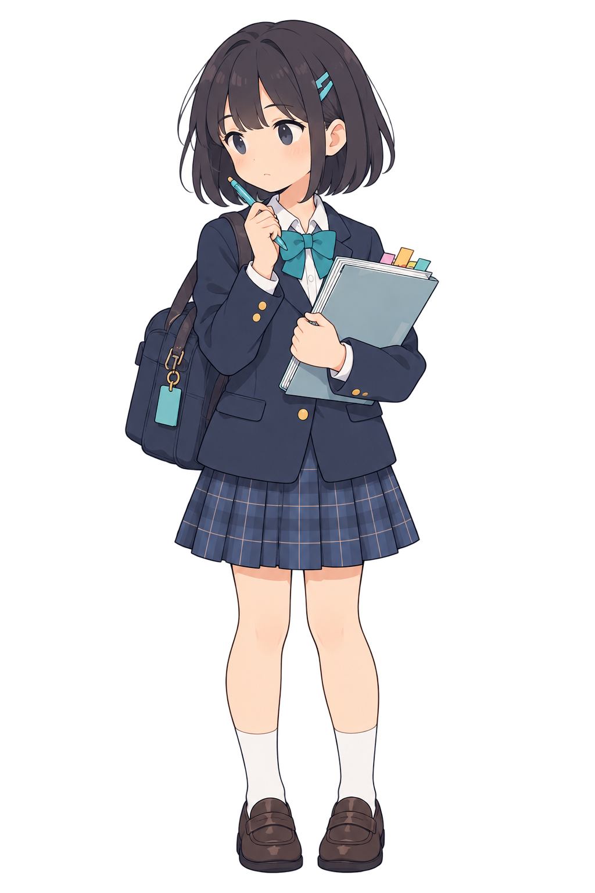
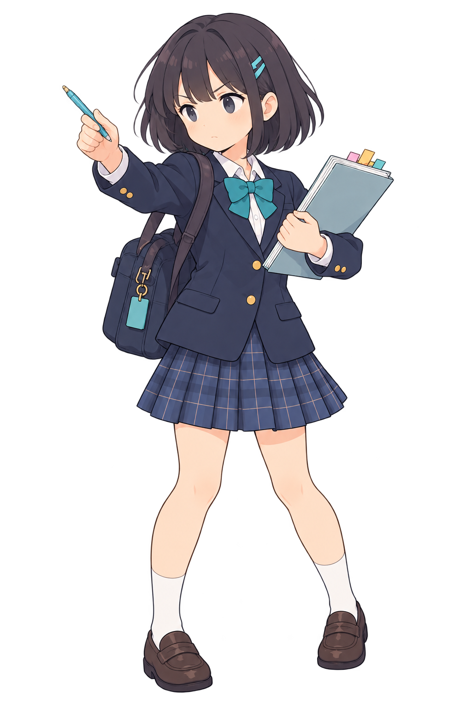
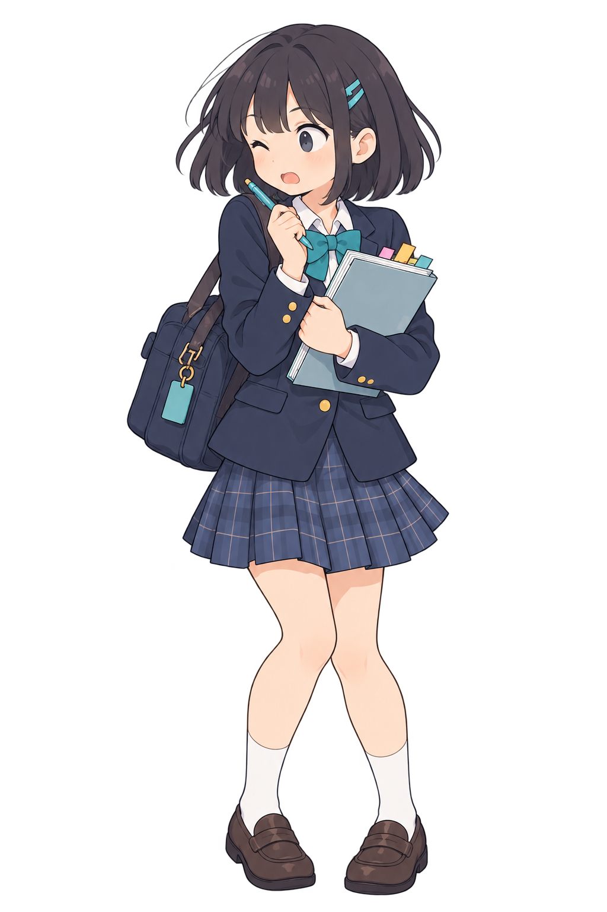

# 真面目な子・3ポーズ候補の比較記録

Issue [#29](https://github.com/sato0825/school-rg/issues/29)。基準画の**年齢感と柔らかい作画方向**はユーザー確認済み。以下3枚の個別画像、ゲーム素材としての採用、アニメーションは未承認です。

| 状態 | 候補 | 予備確認 | 残る問題 |
| --- | --- | --- | --- |
| 待機 |  | 短いボブ、青緑のピン、制服とノート、丸い顔を基準画から保持 | ラスタ一枚。部位別原本と接地・揺れの基準なし |
| 発動 |  | 同じ小物と制服を保持し、入力完了の動作として読める | 腕と顔の角度、全身の幅が大きく変わる。切替時の中間フレームとUI干渉は未検査 |
| 被弾 |  | 過度な暴力表現なく短い驚きの反応として読める | 顔つきと脚の形の変化、待機へ戻る遷移を未検査 |

自動検査で3枚のキャンバスは1024×1536、透明領域と描画領域があり、ハッシュは台帳と一致しました。これは見た目の同一性を判定しません。現段階の判定は**候補の保管・比較のみ**です。既存の戦闘素材の置換や #29 のクローズは行いません。
