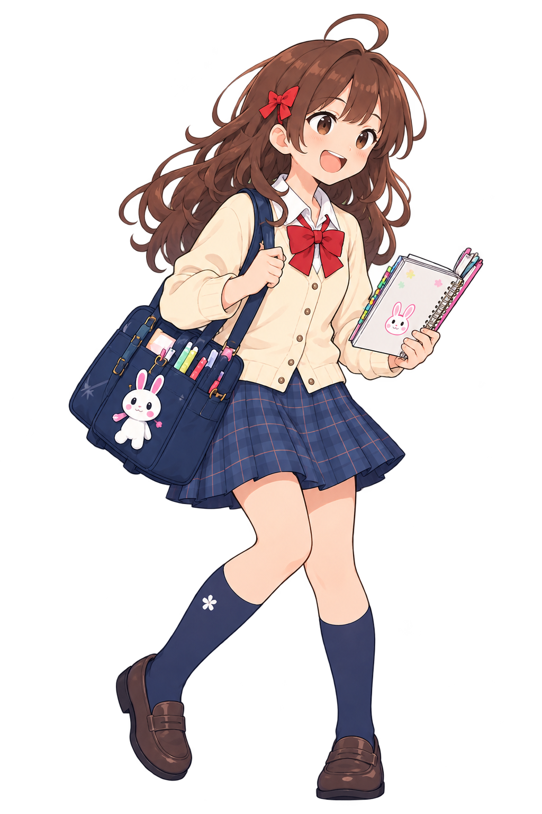
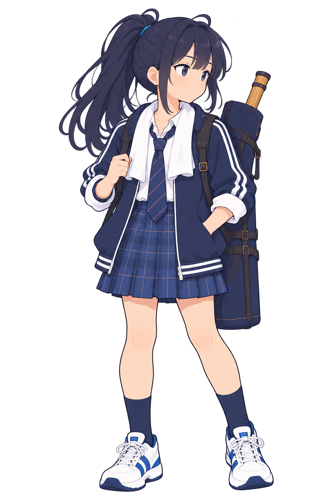
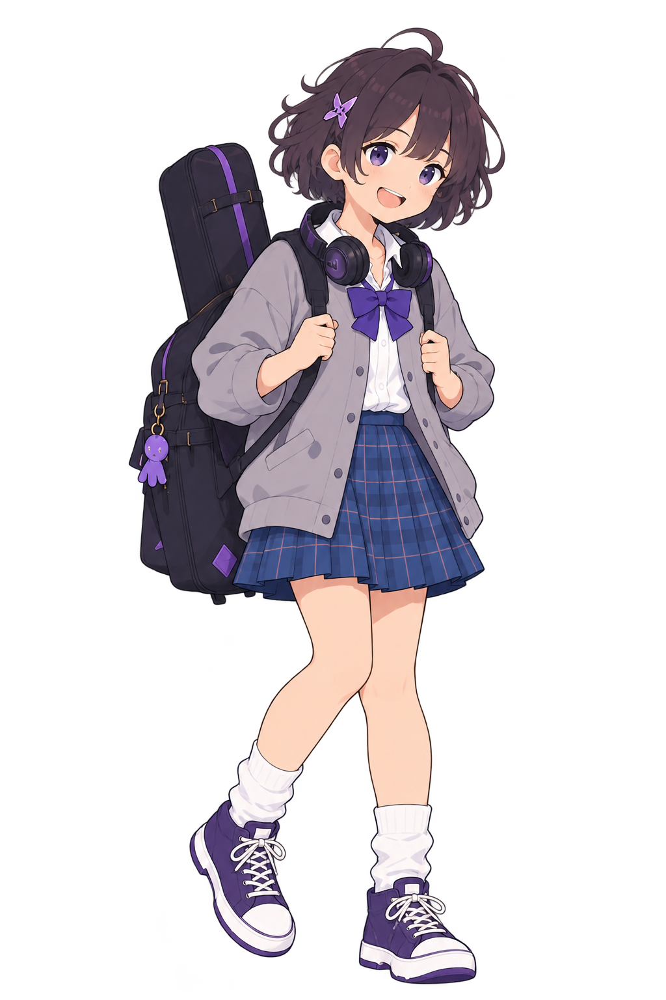
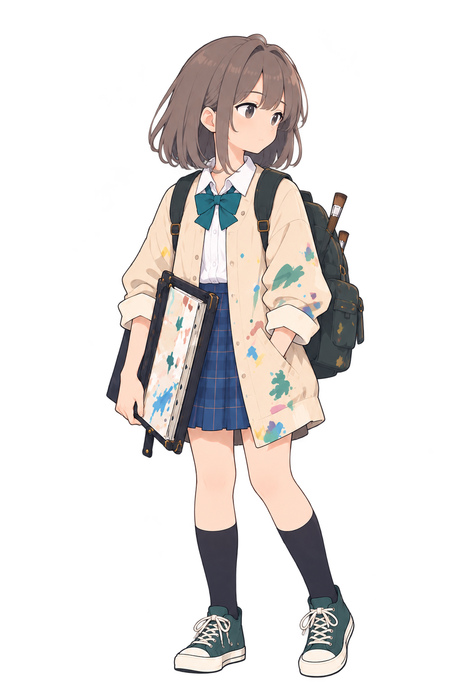

# 4人の全身基準候補・比較記録（#92）

入力は[5人並び絵](reference/five-students-lineup-draft.png)と[年齢感・画風の承認済み方向](reference/serious-student-approved-direction.png)です。4枚とも同じ制作回のbuilt-in imagegenで透過全身として生成しました。表示用に拡大・切り抜き・背景合成はしていません。**並び絵自体と4枚の候補は未承認**で、ランタイムには組み込みません。

| 仮の部活・人物ID | 候補 | 並び絵から保持した特徴 | 目視で残る課題 |
| --- | --- | --- | --- |
| 文芸・`literature-student` |  | 茶色の長い髪、赤いリボン、クリーム色の上着、ノート、ウサギ飾りの鞄 | 鞄とノートの描き込みが増えた。基準画より口と瞳が大きいので、全員を並べた時の顔の比率を再確認する |
| 剣道・`kendo-student` |  | 高いポニーテール、白線の紺ジャケット、長い道具袋、運動靴 | 他の3人より脚が長く見える。設定上の身長差と頭身差を分けて確定する |
| 軽音・`music-student` |  | 短い癖毛、星の髪留め、紫のリボン・ヘッドホン・楽器ケース | 顔が丸く目が大きいため、文芸・剣道と線・瞳の基準を揃える。ケースの肩紐を動作用に定義する |
| 美術・`art-student` |  | 灰茶のボブ、青緑のリボン、絵の具跡のある上着、画板と筆 | 画板と手の接点、小物の寸法を固定する。表情の静かさは保ちつつ大人びた印象へ寄せない |

共通検査では全候補が1024×1536のRGBA PNG、透明画素と描画画素を持ち、SHA-256が素材台帳と一致しました。これは顔・線・体格・衣装の同一性を証明しません。画風は同じ方向に見えますが、顔の描き方と頭身に差が残ります。個別の姿勢・表情・小物の修正を経て、編集可能な部位別原本から待機・発動・被弾を作る必要があります。

今回の判定は**比較候補として保管**です。5人の人物設定、候補の採否、量産時の再現性とアニメーション品質は #29/#31 に残します。基準画・生成指示・素材ID・SHAを保持し、修正時は新しい版を作ります。
