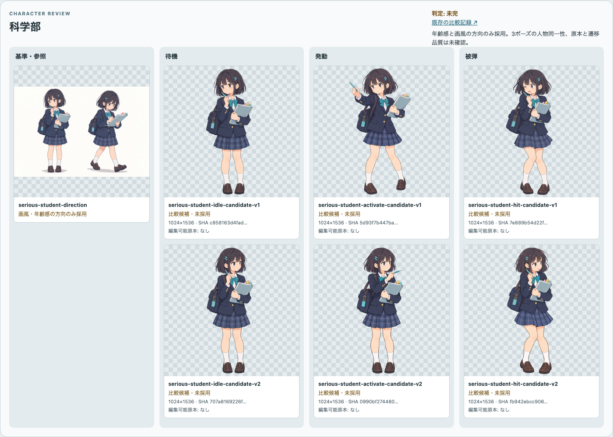
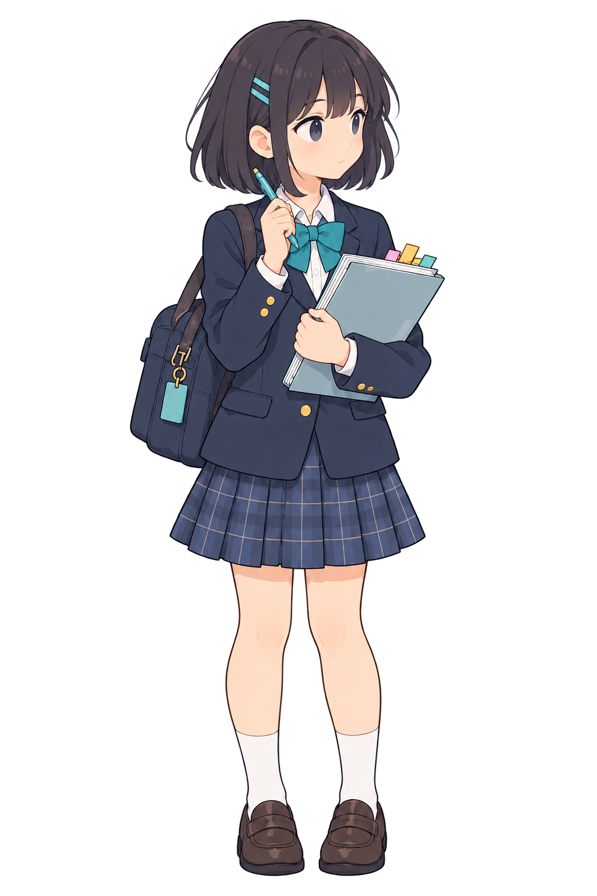
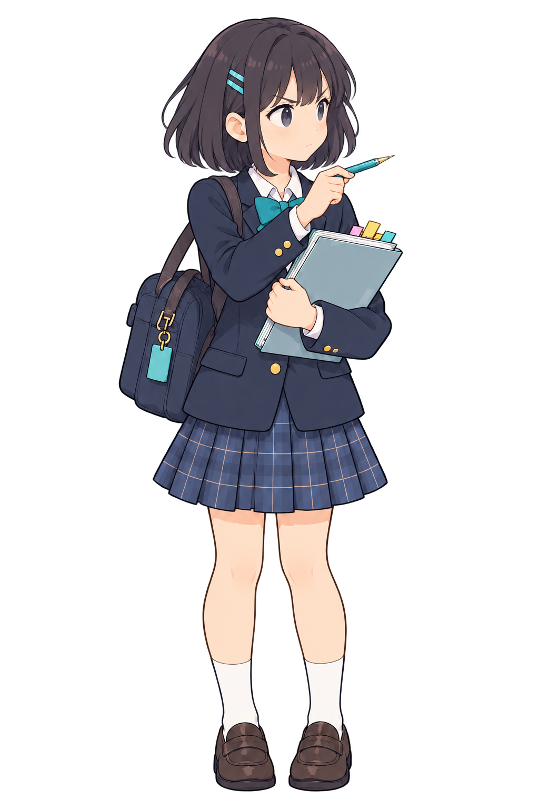
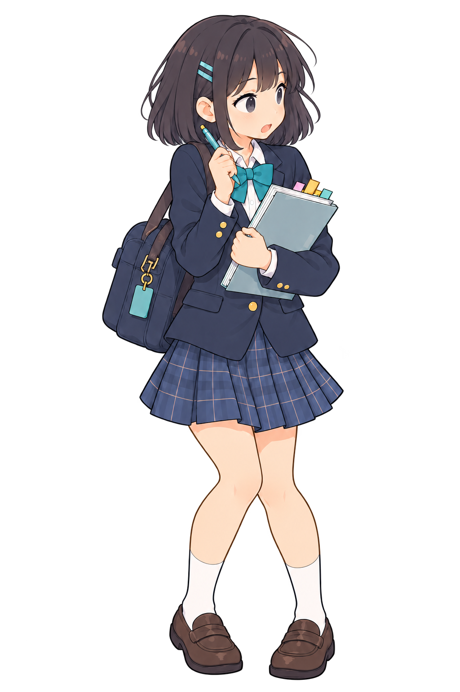

# 科学部の対面方向レビュー（Issue #178）

## 対象と判定

戦闘画面の味方は左、敵は右。旧待機・発動・被弾 v1 は科学部だけ顔と発動の鉛筆が左へ向き、敵との対面が読みにくかった。新 v2 は3状態とも顔・視線を右へ向け、発動時の鉛筆も右へ向けた。旧ファイルを保持し、`club-presentation.ts` の科学部参照だけ v2 へ変更した。他の4部活の待機絵は右または正面寄りで、この問題は確認しなかった。

[同条件の比較ボード](review-board.html#serious-student)に台帳から旧 v1 と新 v2 の各3ポーズを並べた。

| 状態 | 旧 v1 | 新 v2 | 目視結果 |
| --- | --- | --- | --- |
| 待機 |  |  | 敵を見る右向き。年齢感、髪、制服、鞄、ノートの特徴は残る。 |
| 発動 |  |  | 旧版は鉛筆を左へ突き出す。新版は同じ画面内位置の鞄とノートを保ち、鉛筆の先を右へ向ける。動きの幅は小さい。 |
| 被弾 |  |  | 右側からの攻撃に驚くが、背中を向けない。浮いた驚き記号は除去し、エフェクトをキャラ素材へ焼き込まない。 |

## ゲーム画面

- [PC 1440×900](previews/issue178-science-facing-pc-1440x900.png): 主人公の表示矩形 x=163–472、敵 x=889–1299。顔は右側を向き、広い校舎背景の独立した前景に見える。人物、敵、Intent、入力帯は重ならない。横スクロールなし。
- [iPad相当 1024×768](previews/issue178-science-facing-ipad-1024x768.png): 主人公 x=112–342、敵 x=625–927。ステージは y=72–442、入力帯は y=442 以降。人物と敵の間に余白があり、横スクロールなし。
- Playwright の科学部3ポーズ切替テストは待機→敵攻撃中の被弾→待機→カード入力の発動→待機を確認した。画面キャプチャは独立 Chromium の viewport 確認であり、実機 iPad の操作合格ではない。

## 残る制作ゲート

候補は見た目上同じ人物だが、髪留めの見える側や手の細部の完全一致、各ポーズ間の補間、編集可能な部位別原本、別制作回での再現性は未証明。#29 の比較ボードと人の採否判断を要する。3状態を画面へ仮表示したことを最終アート承認と扱わない。
