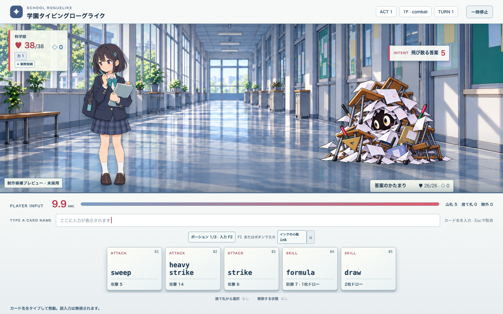
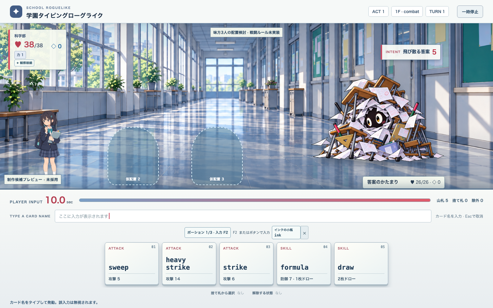
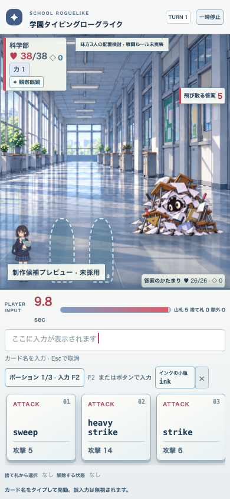

# 可変戦闘ステージの配置仕様 v0.1

親: [#30](https://github.com/sato0825/school-rg/issues/30)、子: [#86](https://github.com/sato0825/school-rg/issues/86)。複数味方の採用、カード所有、HP・対象選択・敵AIのルールは未決定です。この資料は画角と配置だけを扱います。

戦闘背景は全幅の独立プレートとし、味方、敵、エフェクト、HUD、入力帯を別の表示層に置きます。`stage-layout.ts` はステージ幅に対する中心位置を返し、現在の単独戦闘も同じ配置を使います。味方は1〜3枠、敵は0〜5枠を計算できます。0人の敵は勝利への遷移中に使います。

| 味方数 | 中心位置（ステージ幅％） | 縮小する高さ |
| --- | --- | --- |
| 1 | 22 | 90％ |
| 2 | 17、37 | 63％、狭幅45％ |
| 3 | 10、27、44 | 47％、狭幅31％ |

敵側は1体76％、2体68・85％、3体62・77・92％です。4〜5体はさらに縮小した配置を用意します。複数味方の見本は `?layoutPreview=2` または `?layoutPreview=3` で表示し、追加枠は「仮配置」と明記した非操作のプレースホルダーです。実際のHP、カード、行動を持つキャラクターではありません。

E2Eは1440×900と390×844で、1〜3味方の枠が背景外・入力帯へ出ず、互いと敵枠に重ならないことを実測します。これだけでは別キャラの身長比、動作時の伸び、エフェクトの範囲、将来の複数味方戦闘ルールは合格しません。

実画面の確認では、単独は広い背景を保ち、3枠も幾何的には重なりませんでした。ただし390px幅の3枠では主人公がかなり小さくなります。人物ごとの身長比、前後関係、HUDとエフェクトを含む最終的な複数味方の画面品質は未合格として親 #30 と #29 に残します。配置検討ラベルはHUDを避けて中央上部へ移しました。

## 実画面の比較

| 単独・1440×900 | 3枠・1440×900 | 3枠・390×844 |
| --- | --- | --- |
|  |  |  |

追加枠は実キャラクターではありません。小画面での小ささと、実際の3人の表情・動き・ターゲット表示の不足を解決する前に、複数味方戦闘の採用や画面完成を宣言しません。
